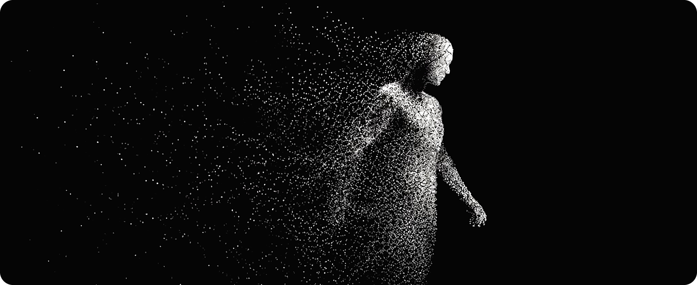
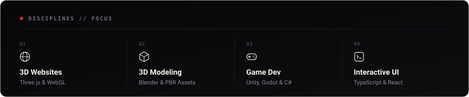
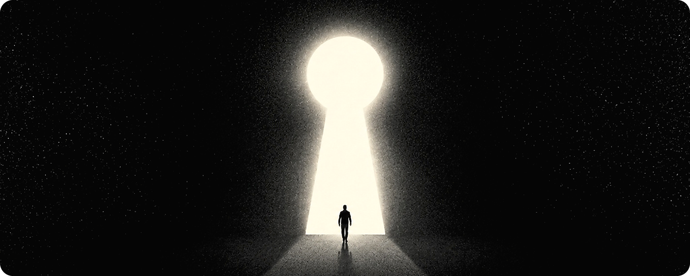

<div align="center">
  

  <br/><br/>

  <h2>ADLI HAKIMARZUQ SABEKTI</h2>
  <p>Creative Developer &nbsp;·&nbsp; 3D Web &nbsp;·&nbsp; 3D Modeling &nbsp;·&nbsp; Game Development</p>
  <p>
    <a href="https://hakimarzuq.github.io"><b>hakimarzuq.github.io</b></a> &nbsp;·&nbsp;
    <a href="https://github.com/hakimarzuq?tab=repositories">Repositories</a>
  </p>
</div>

<br/>

### 01 · About

Hi, I'm **Adli** (`@hakimarzuq`). I work where light, geometry, and code meet—building interactive **3D websites**, crafting **3D models**, and exploring **real-time game development**.

```ts
const adli = {
  focus: ["3D Websites", "3D Modeling", "Game Development"],
  tools: ["Three.js", "Blender", "Unity", "Godot"],
  ethos: "Stay rare. Build with depth.",
};
```

<br/>

<div align="center">
  
</div>

<br/>

### 02 · Stack

<p>
  
  
  
  
  
  <br/>
  
  
  
  
  
  
  
  
</p>

<br/>

### 03 · Activity

<div align="center">
  
  
</div>

<br/>

<div align="center">
  
  <br/><br/>
  <sub><i>"In shadow, form is remembered. Stay rare."</i></sub>
  <br/><br/>
  <a href="https://hakimarzuq.github.io">Portfolio</a> &nbsp;·&nbsp;
  <a href="https://github.com/hakimarzuq">GitHub</a>
  <!-- &nbsp;·&nbsp; <a href="https://linkedin.com/in/USERNAME">LinkedIn</a> -->
  <!-- &nbsp;·&nbsp; <a href="mailto:EMAIL_KAMU@gmail.com">Email</a> -->
  <!-- &nbsp;·&nbsp; <a href="https://www.artstation.com/USERNAME">ArtStation</a> -->
  <!-- &nbsp;·&nbsp; <a href="https://USERNAME.itch.io">itch.io</a> -->
</div>
