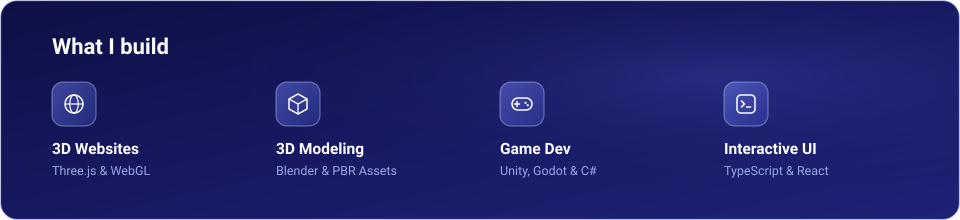

<div align="center">
  

  <br/><br/>

  <h2>Adli Hakimarzuq Sabekti</h2>
  <p>Creative Developer &nbsp;·&nbsp; 3D Web &nbsp;·&nbsp; 3D Modeling &nbsp;·&nbsp; Game Development</p>
  <p>
    <a href="https://hakimarzuq.github.io"><b>hakimarzuq.github.io</b></a> &nbsp;·&nbsp;
    <a href="https://github.com/hakimarzuq?tab=repositories">Repositories</a>
  </p>
</div>

<br/>

### About

Hi, I'm **Adli** (`@hakimarzuq`). I'm focused on crafting interactive **3D experiences on the web**, modeling **3D worlds**, and building **real-time games**—where clean engineering meets atmospheric visual design.

```ts
const adli = {
  focus: ["3D Websites", "3D Modeling", "Game Development"],
  tools: ["Three.js", "Blender", "Unity", "Godot"],
  portfolio: "https://hakimarzuq.github.io",
};
```

<br/>

<div align="center">
  
</div>

<br/>

### Stack

<p>
  
</p>

<br/>

### Stats

<div align="center">
  
  
</div>

<br/>

<div align="center">
  
  <br/><br/>
  <a href="https://hakimarzuq.github.io">Portfolio</a> &nbsp;·&nbsp;
  <a href="https://github.com/hakimarzuq">GitHub</a>
  <!-- &nbsp;·&nbsp; <a href="https://linkedin.com/in/USERNAME">LinkedIn</a> -->
  <!-- &nbsp;·&nbsp; <a href="mailto:EMAIL_KAMU@gmail.com">Email</a> -->
  <!-- &nbsp;·&nbsp; <a href="https://www.artstation.com/USERNAME">ArtStation</a> -->
  <!-- &nbsp;·&nbsp; <a href="https://USERNAME.itch.io">itch.io</a> -->
</div>
