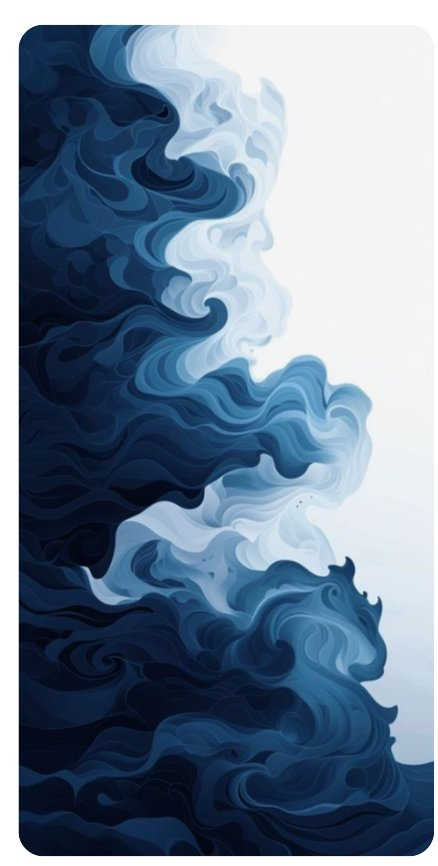
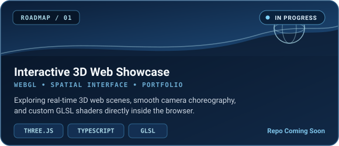
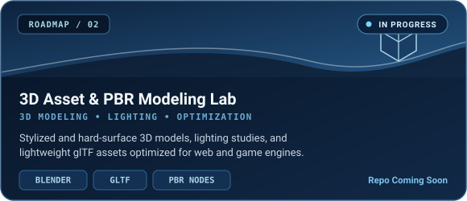
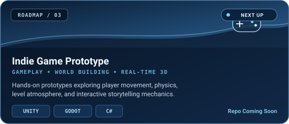

<div align="center">
  

  <br/><br/>

  <a href="https://github.com/hakimarzuq">
    
  </a>
  <a href="https://github.com/hakimarzuq">
    
  </a>
  <a href="https://github.com/hakimarzuq?tab=repositories">
    
  </a>
</div>

---

## 🌊 About Me

<table>
  <tr>
    <td width="64%" valign="top">

Hi! I'm **Adli Hakimarzuq Sabekti** (`@hakimarzuq`) — an aspiring creative developer passionate about bringing **3D experiences to the web**, crafting **3D models**, and building **interactive games**.

I love the intersection between **code and visual art**: turning geometry, shaders, lighting, and physics into worlds people can explore right on their screen.

```ts
const hakimarzuq = {
  name: "Adli Hakimarzuq Sabekti",
  interests: [
    "3D Websites & Spatial UI",
    "3D Modeling & PBR Texturing",
    "Game Development & Mechanics",
  ],
  currentlyExploring: ["Three.js", "WebGL / GLSL", "Blender", "Unity / Godot"],
  mindset: "Code with structure, design with depth.",
};
```

</td>
    <td width="36%" valign="center" align="center">



<br/><br/>

> *"Great 3D experiences happen where clean engineering meets visual storytelling."*

</td>
  </tr>
</table>

---

## 🛠️ Tech Stack & Creative Tools

### 🌐 3D Web & Frontend
<p>
  
</p>

`HTML5` · `CSS3` · `JavaScript` · `TypeScript` · `React` · `Three.js` · `WebGL / GLSL`

### 🎮 Game Development
<p>
  
</p>

`Unity` · `Unreal Engine` · `Godot` · `C#` · `C++`

### 🧊 3D Modeling & Developer Tools
<p>
  
</p>

`Blender` · `Figma` · `VS Code` · `Git` · `GitHub`

---

## 🚀 Building Next (Project Roadmap)

<div align="center">
  
  
  <br/>
  
</div>

<br/>

<details>
  <summary><b>🧭 What I'm currently exploring in 3D Web, Modeling & Game Dev</b></summary>
  <br/>
  <ul>
    <li><b>3D Websites:</b> Scene optimization, camera transitions, lighting setups, and interactive glTF loading with Three.js.</li>
    <li><b>3D Modeling:</b> Hard-surface & stylized modeling in Blender, UV unwrapping, PBR material nodes, and baking for real-time engines.</li>
    <li><b>Game Development:</b> Core gameplay loops, character controllers, shader effects, and world-building prototypes.</li>
  </ul>
</details>

---

## 📊 GitHub Analytics

<div align="center">
  
  
</div>

---

## 🤝 Connect

<div align="center">
  <a href="https://github.com/hakimarzuq">
    
  </a>

  <!--
  Uncomment and replace the links below whenever your social accounts or portfolios are ready:

  <a href="https://linkedin.com/in/USERNAME">
    
  </a>
  <a href="mailto:EMAIL_KAMU@gmail.com">
    
  </a>
  <a href="https://www.artstation.com/USERNAME">
    
  </a>
  <a href="https://USERNAME.itch.io">
    
  </a>
  -->
</div>
